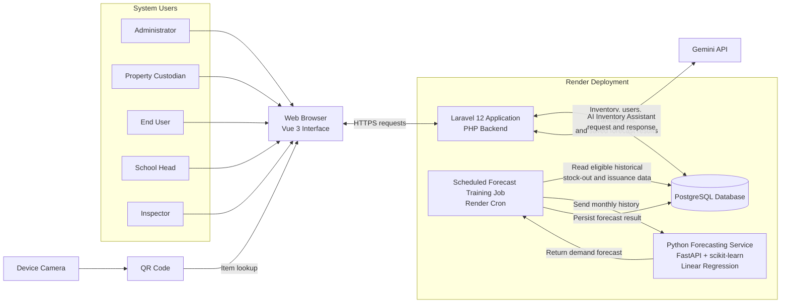

@startuml
left to right direction

actor "Administrator" as Admin
actor "Property Custodian" as Custodian
actor "End User" as User
actor "School Head" as Head
actor "Inspector" as Inspector
actor "Forecast Service\n(Linear Regression)" as ML
actor "Gemini API" as Gemini

rectangle "DNHS Inventory Management System" {
  usecase "Sign in / Sign out" as Auth
  usecase "Manage Profile" as Profile

  usecase "Manage Users and Roles" as Users
  usecase "Configure System and AI Settings" as Settings
  usecase "View Administrative Reports" as AdminReports

  usecase "View and Manage Inventory" as Inventory
  usecase "Record Stock-In and Stock-Out" as Transactions
  usecase "Scan QR Code / Look Up Item" as QR
  usecase "Manage Item Requests" as Requests
  usecase "Manage Assignments, Returns,\nand Transfers" as AssetFlow
  usecase "Manage Maintenance, Incidents,\nand Disposal" as Maintenance
  usecase "Conduct Arrival Inspection" as Inspection
  usecase "View Inventory Reports" as Reports
  usecase "Generate Demand Forecast" as Forecast
  usecase "View Procurement Recommendations" as Procurement
usecase "Ask AI Inventory Assistant" as Assistant

  usecase "Submit Item Request" as SubmitRequest
  usecase "View Assigned Items" as Assigned
  usecase "Request Return or Transfer" as ReturnTransfer
  usecase "Report an Item Issue" as ReportIssue

  usecase "View Inventory Overview\nand Audit Logs" as Overview
}

Admin --> Auth
Admin --> Profile
Admin --> Users
Admin --> Settings
Admin --> AdminReports

Custodian --> Auth
Custodian --> Profile
Custodian --> Inventory
Custodian --> Transactions
Custodian --> QR
Custodian --> Requests
Custodian --> AssetFlow
Custodian --> Maintenance
Custodian --> Reports
Custodian --> Forecast
Custodian --> Procurement
Custodian --> Assistant

User --> Auth
User --> Profile
User --> SubmitRequest
User --> Assigned
User --> ReturnTransfer
User --> ReportIssue

Head --> Auth
Head --> Profile
Head --> Overview
Head --> Reports
Head --> Assistant

Inspector --> Auth
Inspector --> Profile
Inspector --> Inspection
Inspector --> Reports
Inspector --> Assistant

ML --> Forecast
Gemini --> Assistant

@enduml

## System Architecture

