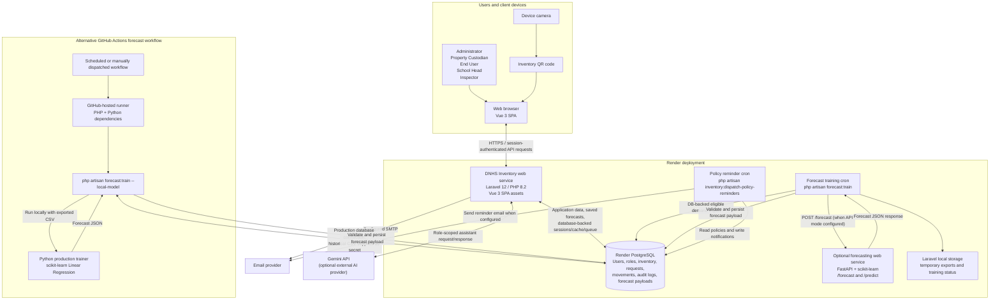

# DNHS Inventory Management System: Use Cases and Architecture

## Use-case diagram

```plantuml
@startuml
left to right direction

actor "Administrator" as Admin
actor "Property Custodian" as Custodian
actor "End User" as EndUser
actor "School Head" as Head
actor "Inspector" as Inspector

rectangle "DNHS Inventory Management System" {
  package "Account Access" {
    usecase "Register / Sign In / Sign Out" as Auth
    usecase "Manage Own Profile" as Profile
  }

  package "Administration" {
    usecase "Manage User Accounts and Roles" as Users
    usecase "Approve or Reject User Accounts" as ApproveUsers
    usecase "Configure System, Inventory,\nand AI Settings" as Settings
    usecase "View and Export Administrative Reports" as AdminReports
  }

  package "Inventory Operations" {
    usecase "View and Manage Inventory\nand Categories" as Inventory
    usecase "Record Stock-In" as StockIn
    usecase "Record Stock-Out and Assign Items" as Issue
    usecase "Scan QR Code and Find Item" as QR
    usecase "Process Item Requests" as Requests
    usecase "Manage Assignments, Returns,\nand Transfers" as AssetLifecycle
    usecase "Inspect Deliveries and Approve IAR" as ArrivalInspection
    usecase "Manage Incident Reports,\nMaintenance, and Disposal" as Incidents
    usecase "View and Export Inventory Reports" as Reports
  }

  package "Forecast and Assistance" {
    usecase "Train and Save Live Demand Forecast" as TrainForecast
    usecase "View Demand Forecast and\nProcurement Recommendations" as Forecast
    usecase "Request Forecast Explanation\nor Decision Support" as ForecastHelp
    usecase "Ask AI Inventory Assistant" as Assistant
  }

  package "Oversight" {
    usecase "View Dashboard and Inventory Overview" as Overview
    usecase "View and Export Audit Logs" as AuditLogs
  }

  package "End-user Self-Service" {
    usecase "Submit and Track Item Requests" as MyRequests
    usecase "View Assigned Items" as MyAssigned
    usecase "Request Return or Transfer" as MyReturnTransfer
    usecase "Report Item Issue" as MyIssue
  }

  package "Arrival Inspection" {
    usecase "Create and Record Arrival Inspection" as CreateInspection
    usecase "Update Inspection and Generate IAR" as UpdateInspection
    usecase "Review Inspection Approval or Correction" as ReviewInspection
  }
}

Admin --> Auth
Admin --> Password
Admin --> Onboarding
Admin --> Profile
Admin --> Users
Admin --> ApproveUsers
Admin --> Settings
Admin --> AdminReports

Custodian --> Auth
Custodian --> Password
Custodian --> Onboarding
Custodian --> Profile
Custodian --> Inventory
Custodian --> StockIn
Custodian --> Issue
Custodian --> QR
Custodian --> Requests
Custodian --> AssetLifecycle
Custodian --> ArrivalInspection
Custodian --> Incidents
Custodian --> Reports
Custodian --> Forecast
Custodian --> ForecastHelp
Custodian --> Assistant

EndUser --> Auth
EndUser --> Password
EndUser --> Onboarding
EndUser --> Profile
EndUser --> MyRequests
EndUser --> MyAssigned
EndUser --> MyReturnTransfer
EndUser --> MyIssue

Head --> Auth
Head --> Password
Head --> Onboarding
Head --> Profile
Head --> Overview
Head --> Reports
Head --> AuditLogs

@enduml
```

### Role notes

- New End User accounts can be registered; the Administrator manages and
  approves or rejects accounts as applicable. Administrators can also create
  and manage accounts.
- Inventory mutations and demand-forecast/procurement functions are assigned
  to the Property Custodian.
- The School Head has oversight views, including inventory overview and audit
  logs; this role does not perform the custodian's inventory workflows.
- The Inspector records arrival inspections and generates inspection
  documents. The Property Custodian reviews inspected arrivals and approves
  them or returns them for correction.
- The AI Inventory Assistant is limited by the system's capability policy.
  The current inventory-query capabilities are assigned to the Property
  Custodian; Gemini is an external provider, not a system user.
- Forecast training is automated by a scheduled workflow. Depending on the
  selected deployment path, it runs the Python trainer on GitHub Actions or
  calls the optional continuously hosted FastAPI forecasting service.

## System architecture

The repository currently describes two ways to train the live forecast:

1. **GitHub Actions local-model workflow:** the workflow runs
   `php artisan forecast:train --local-model --no-interaction`, connects to
   PostgreSQL, runs the Python trainer on the GitHub-hosted runner, and saves
   the validated forecast to the database.
2. **Render cron plus forecasting API:** the Render blueprint also defines a
   daily forecast cron and an optional FastAPI service. The cron command
   `php artisan forecast:train --no-interaction` uses `FORECAST_API_URL` and
   `FORECAST_API_TOKEN` to call the API, then saves the result to PostgreSQL.

These are alternative training paths to the same live forecast record.
Configure only one scheduled training path at a time to avoid redundant runs
or one workflow overwriting another's result. The Laravel web service reads
the saved live forecast; user page reloads do not themselves train the model.

The Render blueprint also defines a separate daily inventory-policy reminder
cron. It reads and updates database records and sends email only when SMTP is
configured. Laravel's sessions, cache, and queue use the configured database
in the Render deployment. Temporary exports/status files use Laravel storage
and are not the durable location for live forecast results.

Gemini is optional. When configured, assistant requests are mediated by
Laravel's role/capability checks; the provider does not receive direct
database access. QR scanning uses the device camera in the browser, and the
resulting code is looked up through the application.
